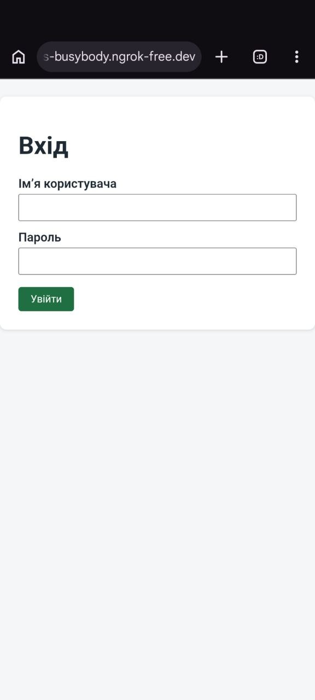
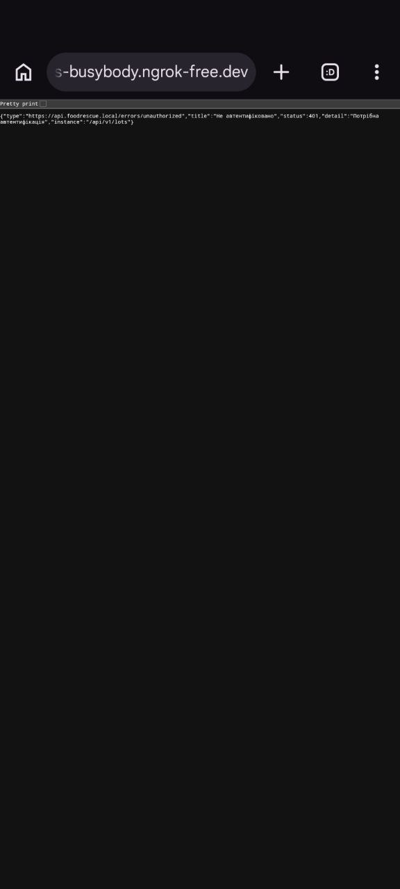
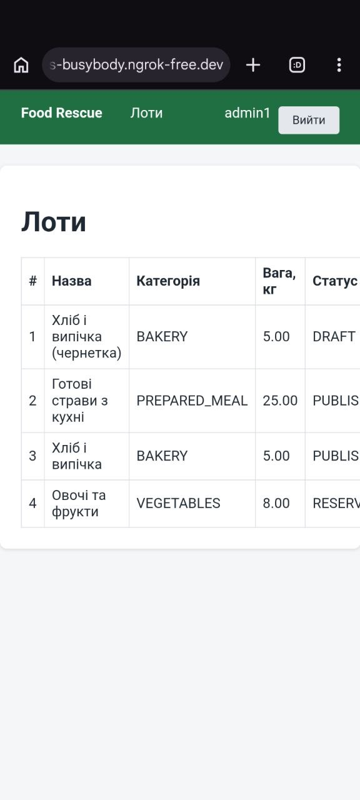

# Звіт про розгортання Food Rescue

**Дата перевірки:** 03.11.2026

## 1. Обрана архітектура

Застосунок успішно зібрано та запущено в ізольованому Docker-середовищі через Docker Compose на локальній машині (Windows, Docker Desktop). Цей варіант дозволений груповим завданням лекції 9 як альтернатива VPS із systemd. Процес застосунку ізольований у контейнері та працює без прав root.

```
Перевірено: локальний клієнт → localhost:8080 → Docker-контейнер → Spring Boot → H2 в пам'яті
Перевірено ззовні: телефон → публічна адреса ngrok (HTTPS) → тунель → localhost:8080 → Docker-контейнер → Spring Boot → H2
```

Контейнер збирається багатоетапним `Dockerfile`: на першому етапі образ `eclipse-temurin:25-jdk` збирає jar командою `./mvnw -B -DskipTests package`, на другому образ `eclipse-temurin:25-jre` містить готовий jar. Збірка Docker-образу 03.11.2026 завершилася з результатом `BUILD SUCCESS`, контейнер мав статус `Up`. Тести не запускаються під час збірки образу (для інтеграційних тестів потрібне окреме Docker-середовище); перевірка `./mvnw verify` виконується окремо й не входить до наведеного результату збірки.

## 2. Файли налаштувань

Файли налаштування розгортання розміщені в корені репозиторію, а `application.properties` — у `src/main/resources/`. Файл із секретами `deploy.env` додано в `.gitignore` і `.dockerignore`; у репозиторії залишається шаблон `deploy.env.example` без справжніх секретів.

**`Dockerfile`**

```dockerfile
FROM eclipse-temurin:25-jdk AS build
WORKDIR /build
COPY .mvn .mvn
COPY mvnw pom.xml ./
COPY src src
RUN ./mvnw -B -DskipTests package

FROM eclipse-temurin:25-jre
RUN groupadd --system app && useradd --system --gid app --no-create-home app
WORKDIR /opt/foodrescue
RUN mkdir logs && chown app:app logs
COPY --from=build /build/target/*.jar app.jar
USER app
EXPOSE 8080
ENTRYPOINT ["java", "-jar", "app.jar"]
```

Системний користувач `app` запускає процес замість root. Каталог `logs` створюється заздалегідь і передається цьому користувачу, бо `logback-spring.xml` пише журнал у `logs/foodrescue.log`, а без цього каталогу застосунок не стартує.

**`.dockerignore`**

```
target
deploy.env
.git
```

**`compose.yaml`**

```yaml
services:
  app:
    build: .
    image: foodrescue:latest
    env_file: deploy.env
    ports:
      - "8080:8080"
    restart: unless-stopped
    stop_grace_period: 40s
```

`env_file` передає секрети змінними середовища, `restart: unless-stopped` вмикає автозапуск, а `stop_grace_period` (40 с) більший за час очікування Spring (30 с), щоб Docker не вбив контейнер раніше, ніж завершаться активні запити.

**`deploy.env.example`** (шаблон без справжніх значень; копія `deploy.env` у `.gitignore`)

```
JWT_SECRET=<random string of at least 32 bytes>
FOODRESCUE_DEMO_PASSWORDS_DONOR1=<password>
FOODRESCUE_DEMO_PASSWORDS_VOLUNTEER1=<password>
FOODRESCUE_DEMO_PASSWORDS_COORDINATOR1=<password>
FOODRESCUE_DEMO_PASSWORDS_ADMIN1=<password>
```

`JWT_SECRET` перевизначає `security.jwt.secret`, а змінні `FOODRESCUE_DEMO_PASSWORDS_*` перевизначають паролі демо-акаунтів `foodrescue.demo.passwords.*` з `application.properties`.

**`application.properties`** (властивості безпечного завершення)

```properties
server.shutdown=graceful
spring.lifecycle.timeout-per-shutdown-phase=30s
```

**`foodrescue.service` (підготовлений варіант для VPS)**

```ini
[Unit]
Description=Food Rescue Service
After=network.target

[Service]
Type=simple
User=foodrescue
Group=foodrescue
WorkingDirectory=/opt/foodrescue
EnvironmentFile=/etc/foodrescue/foodrescue.env
ExecStart=/usr/bin/java -jar /opt/foodrescue/foodrescue.jar
SuccessExitStatus=143
TimeoutStopSec=40
Restart=always
RestartSec=10
ProtectSystem=full
PrivateTmp=true

[Install]
WantedBy=multi-user.target
```

Для запуску через systemd потрібні Linux із Java 25, системний користувач `foodrescue`, jar за шляхом `/opt/foodrescue/foodrescue.jar` та захищений файл `/etc/foodrescue/foodrescue.env`. Файловий журнал Logback записується в `logs/foodrescue.log` відносно `WorkingDirectory`, тому `/opt/foodrescue/logs` має бути доступний для запису користувачу `foodrescue`. Справжніх паролів і ключів у звіті немає.

## 3. Зовнішній доступ (частина другої ролі)

**Дата перевірки:** 03.11.2026. Для доступу з Інтернету використано тунель ngrok до того самого Docker-контейнера (`docker compose up -d --build`, контейнер `Up`, процес від користувача `app`). Тунель запущено командою `ngrok http 8080` на машині другої ролі (Linux, Docker Compose):

```
Forwarding https://unfilled-guts-busybody.ngrok-free.dev -> http://localhost:8080
```

Публічна адреса на момент перевірки: `https://unfilled-guts-busybody.ngrok-free.dev`. HTTPS дає сам ngrok, застосунок у контейнері далі слухає HTTP на порту 8080.

Запити надсилалися з браузера телефона (Android) на публічну адресу. Усі запити пройшли через публічну точку ngrok і видні в його журналі (`http://127.0.0.1:4040`) з кодами відповідей нижче:

| Запит з телефона | Очікування | Результат | Скриншот |
|---|---|---|---|
| `GET /login` | сторінка входу | `200`, форма «Вхід» | `report-deploy-login.png` |
| `GET /api/v1/lots` без токена | помилка автентифікації у форматі ProblemDetail | `401`, `{"title":"Не автентифіковано","status":401,…,"instance":"/api/v1/lots"}` | `report-deploy-401.png` |
| вхід формою `POST /login` (admin1, пароль із `deploy.env`), потім `GET /lots` | сесія створена, список лотів доступний | `302` після входу, `GET /lots` `200`, сторінка «Лоти» з ім'ям користувача в навігації | `report-deploy-lots.png` |

  

Журнал ngrok показав відомий ризик тунелю (контракт №9, розділ 4.4): відповідь на `POST /login` містить `Location: http://unfilled-guts-busybody.ngrok-free.dev/…`, тобто застосунок формує адресу з `http`, бо не враховує заголовок `X-Forwarded-Proto: https` від ngrok. Браузер телефона сам перейшов на `https`, тому всі наступні запити пройшли по HTTPS. Виправлення — `server.forward-headers-strategy=native`, але контракт дозволяє змінити в `src` лише дві властивості graceful shutdown, тож цю зміну не внесено і її треба окремо погодити й перевірити. Також після входу збережений запит вів на корінь `/?continue`, для якого в застосунку немає сторінки (`404`); список лотів відкрито переходом на `/lots`. Вхід формою перевіряє ту саму автентифікацію за паролем із `deploy.env`, що й REST-вхід; REST-запити з JWT (`POST /api/v1/auth/login`, `GET /api/v1/lots` з токеном) окремо з телефона не виконувалися.


## 4. Автоматичний запуск та ізоляція прав

У вибраному Docker-варіанті `compose.yaml` задає `restart: unless-stopped` — політику перезапуску контейнера, якщо його не зупинили вручну. У `Dockerfile` задано `USER app`, тому JVM працює не від root. Конфігурація передається через `env_file: deploy.env`; файл із секретами не потрібно додавати в репозиторій.

**Фактичні перевірки в Windows PowerShell, 03.11.2026:**

| Перевірка | Команда | Результат |
|---|---|---|
| Збірка та запуск | `docker compose up -d --build` | `BUILD SUCCESS`; образ `foodrescue:latest` зібрано, контейнер створено |
| Стан контейнера | `docker compose ps` | `Up`, порт `8080` опублікований |
| Користувач у контейнері | `docker compose exec app id -un` | `app` (не `root`) |
| Політика перезапуску | `docker inspect $cid --format '{{.HostConfig.RestartPolicy.Name}}'` | `unless-stopped` |
| HTTP-запит | `curl.exe -i http://localhost:8080/login` | `HTTP/1.1 200`; сторінка входу повернулася успішно |

Отже, ізоляцію прав, налаштовану політику перезапуску та локальну доступність перевірено. **Фактичне автоматичне відновлення після аварійного завершення окремо не перевірялося**; команда `docker inspect` підтверджує саме налаштування політики.

Для альтернативного VPS-варіанту підготовлено `foodrescue.service`: `User=foodrescue` і `Group=foodrescue` обмежують права процесу, `ProtectSystem=full` і `PrivateTmp=true` додають ізоляцію, `EnvironmentFile` підключає змінні середовища. `Restart=always` і секція `[Install]` дозволяють увімкнути запуск разом із Linux-системою. Після підготовки VPS адміністратор може виконати:

```bash
sudo install -o root -g root -m 644 foodrescue.service /etc/systemd/system/foodrescue.service
sudo systemctl daemon-reload
sudo systemctl enable --now foodrescue
sudo systemctl is-enabled foodrescue
sudo systemctl status foodrescue
sudo journalctl -u foodrescue -n 50 --no-pager
```

**Перевірка systemd без окремого Linux/VPS:** на Windows через Docker Desktop запущено тимчасовий контейнер `ubuntu:24.04`, встановлено `systemd` і Java Runtime та виконано `systemd-analyze verify /work/foodrescue.service`. Команда завершилася з кодом **`0`** (PowerShell: `$LASTEXITCODE`). Були два попередження: файл позначено як executable і world-writable. Вони пов’язані з правами файлу, змонтованого з Windows до Linux-контейнера, і не спричинили помилки перевірки конфігурації. На реальному VPS юніт потрібно встановлювати з правами `0644` і власником `root:root`, як у команді `install` вище.

Оскільки обрано Docker на Windows, **реальний запуск `foodrescue.service` через `systemctl`, його автозапуск після перезавантаження VPS та журнали `journalctl` не перевірялися**. Юніт залишається підготовленою VPS-альтернативою, а не основним способом розгортання команди.

## 5. Безпечне завершення (graceful shutdown)

У `src/main/resources/application.properties` налаштовано:

```properties
server.shutdown=graceful
spring.lifecycle.timeout-per-shutdown-phase=30s
```

У `compose.yaml` задано `stop_grace_period: 40s`, а в `foodrescue.service` — `TimeoutStopSec=40`. Обидва значення більші за 30-секундний ліміт Spring Boot, тому під час штатної зупинки застосунок має час завершити активні HTTP-запити до примусового припинення процесу.

**Фактична перевірка Docker, 03.11.2026:**

```powershell
docker compose stop
docker compose logs app | Select-String "graceful shutdown"
$cid = docker compose ps -a -q app
docker inspect $cid --format '{{.State.ExitCode}}'
```

Команда `docker compose stop` успішно зупинила контейнер. У журналі зафіксовано:

```text
2026-11-03 09:05:42,542 INFO [SpringApplicationShutdownHook] ... - Commencing graceful shutdown. Waiting for active requests to complete
2026-11-03 09:05:42,552 INFO [tomcat-shutdown] ... - Graceful shutdown complete
```

Код завершення контейнера: **`143`**. Це підтверджує, що Spring Boot отримав сигнал завершення й штатно виконав процедуру graceful shutdown. У цьому запуску зупинка контейнера тривала приблизно одну секунду.

**Межа перевірки:** на момент зупинки не проводився окремий тест із довгим активним запитом. Тому доведено коректну штатну зупинку, але не виміряно збереження відповіді HTTP `200` для запиту, який ще виконується. На VPS таку поведінку також не тестували; `SuccessExitStatus=143` у юніті лише задає трактування цього коду завершення як штатного.

## 6. Підсумок перевірки

Docker-збірка, локальний HTTP-доступ, запуск не від root, політика `unless-stopped` і штатний graceful shutdown **підтверджені фактичними результатами команд**. Файл `foodrescue.service` пройшов статичну перевірку в Ubuntu-контейнері з кодом `0`, але не запускався як Linux-служба. Зовнішній доступ перевірено через публічну HTTPS-адресу ngrok з телефона: сторінка входу, `401` для API без токена і вхід формою до списку лотів (розділ 3); адреса тунелю тимчасова. Дані H2 зберігаються в пам’яті та зникають після перезапуску застосунку; для навчальної демонстрації це допустиме обмеження.
