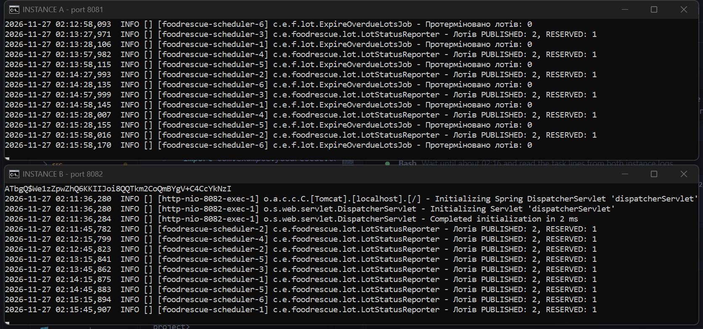
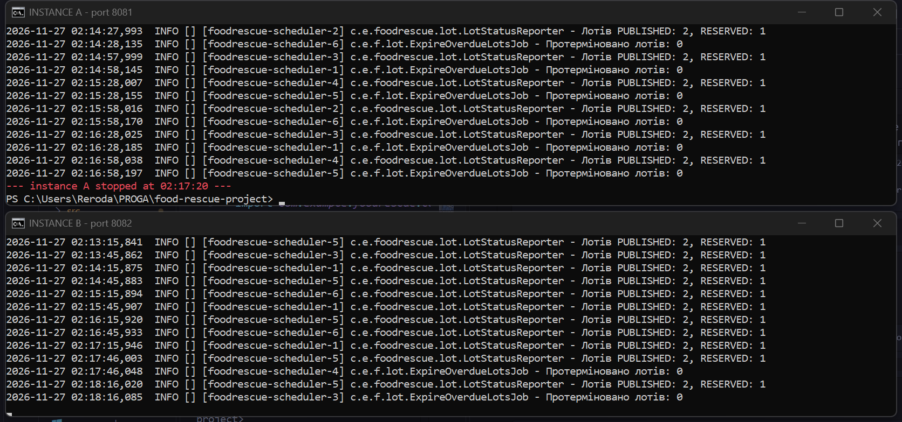

# Звіт про фонові задачі (`@Scheduled`) і розподілені замки (ShedLock) Food Rescue

**Дата перевірки:** 27.11.2026  
**Проєкт:** Food Rescue (Spring Boot 4.1.1, Java 25, Spring Modulith)

## 1. Що зроблено

Частину роботи системи потрібно виконувати без користувача й за розкладом: протермінувати лот, вікно самовивозу якого минуло, зняти прострочений резерв, позначити зависшу доставку. Для цього використано планувальник Spring: анотація `@Scheduled` на методі бін-компонента без аргументів і з типом `void` виконує його з заданою частотою, а `@EnableScheduling` вмикає сканування таких методів. Межа `@Scheduled`: у кожному екземплярі застосунку планувальник свій, тому при кількох екземплярах однакова задача виконується в кожному з них, що для задач, які змінюють дані, небезпечно. Цю проблему розв'язує ShedLock: перед запуском задачі екземпляр бере замок у спільній таблиці `shedlock`, а інші екземпляри в цей час задачу пропускають.

Тому задачі поділено на два типи. Звичайні (`@Scheduled`) лише читають дані й пишуть у журнал, тож їх нормально виконувати в кожному екземплярі. Блоковані (`@Scheduled` разом із `@SchedulerLock`) змінюють спільні дані й мусять виконуватись один раз за цикл на весь кластер.

## 2. Задачі

Усі задачі працюють із `fixedDelay` 30 секунд і `initialDelay` 10 секунд. Обрано `fixedDelay`, а не `fixedRate`: наступний запуск стартує через 30 с після завершення попереднього, тож запуски не накладаються, навіть якщо задача затримається.

### Модуль `lot`

| Клас | Тип | Розклад | Що робить | Чому такий тип |
|---|---|---|---|---|
| `LotStatusReporter` | звичайна (`@Scheduled`) | кожні 30 с | пише в журнал кількість лотів `PUBLISHED` і `RESERVED` (`LotRepository.countByStatus`) | лише читає й не змінює дані, тож замок не потрібен |
| `ExpireOverdueLotsJob` | блокована (`@Scheduled` + `@SchedulerLock`, замок `expireOverdueLots`) | кожні 30 с, `lockAtLeastFor` 25 с, `lockAtMostFor` 5 хв | викликає `LotService.expireOverdue()`: лоти `PUBLISHED`, у яких `pickupTo` минув, переходять у `EXPIRED` через `LotStatusChanger` (історія переходів записується) | змінює спільні дані, тому має виконуватись лише в одному екземплярі за цикл |

Блокована задача реалізує правило БК-4, яке попередні етапи залишили планувальнику: лот, що не забрали до кінця вікна самовивозу, не повинен лишатися опублікованим. Метод сервісу не змінює лот, який уже не `PUBLISHED`, тому задача ідемпотентна: після `lockAtMostFor` замок звільняється навіть при незавершеній задачі, і другий екземпляр може увійти в ту саму роботу, не зашкодивши даним. Час береться з `appClock`.

### Модулі `volunteer` і `delivery`

За тим самим шаблоном (`initialDelay` 10 с, `fixedDelay` 30 с, `lockAtLeastFor` 25 с, `lockAtMostFor` 5 хв) модулі `volunteer` і `delivery` додають по одній звичайній і одній блокованій задачі; їхній опис і знімки додають автори цих модулів у цей розділ:

| Клас | Тип | Що робить |
|---|---|---|
| `VolunteerCountReporter` | звичайна | пише кількість профілів волонтерів |
| `ReleaseOverdueReservationsJob` | блокована (`releaseOverdueReservations`) | лоти `RESERVED` із минулим `reservedUntil` повертаються в `PUBLISHED`, волонтеру додається зрив (`incrementNoShows`) |
| `DeliveryCountReporter` | звичайна | пише кількість доставок |
| `FailStaleDeliveriesJob` | блокована (`failStaleDeliveries`) | лоти `PICKED_UP`, де `pickedUpAt` старший за `foodrescue.scheduling.transit-timeout` (за замовчуванням 6 годин), переходять у `FAILED` |

## 3. Налаштування

**Залежності** (`pom.xml`): `shedlock-spring` і `shedlock-provider-jdbc-template` версії `5.16.0`. Вони не входять у керування залежностями Spring Boot, тому версію вказано явно.

**`SchedulingConfig`** (`common`):

```java
@Configuration
@EnableSchedulerLock(defaultLockAtMostFor = "10m")
public class SchedulingConfig {

    @Bean
    public LockProvider lockProvider(DataSource dataSource) {
        return new JdbcTemplateLockProvider(JdbcTemplateLockProvider.Configuration.builder()
                .withJdbcTemplate(new JdbcTemplate(dataSource))
                .usingDbTime()
                .build());
    }

    @Configuration
    @EnableScheduling
    @ConditionalOnProperty(name = "foodrescue.scheduling.enabled", havingValue = "true", matchIfMissing = true)
    static class Enabled {
    }
}
```

`usingDbTime()` бере час із бази, а не з годинника вузла, тому екземпляри з різним часом не сперечаються про замок. `@EnableScheduling` лежить за вимикачем `foodrescue.scheduling.enabled`: у тестах планувальник не стартує й не змінює дані між тестами, а `@EnableSchedulerLock` лишається, щоб виклик `job.run()` у тесті йшов через замок.

**`schema.sql`** створює окрему таблицю замків ще до запуску Hibernate (Hibernate її не знає):

```sql
CREATE TABLE IF NOT EXISTS shedlock (
    name VARCHAR(64) NOT NULL,
    lock_until TIMESTAMP NOT NULL,
    locked_at TIMESTAMP NOT NULL,
    locked_by VARCHAR(255) NOT NULL,
    PRIMARY KEY (name)
);
```

**`application.properties`:**

```properties
spring.task.scheduling.pool.size=6
spring.task.scheduling.thread-name-prefix=foodrescue-scheduler-
spring.task.scheduling.shutdown.await-termination=true
spring.task.scheduling.shutdown.await-termination-period=30s
spring.sql.init.mode=always
```

Пул з 6 потоків дорівнює кількості задач: типовий один потік зупинив би решту задач, якщо одна зависне. Очікування завершення збігається з плавною зупинкою застосунку (`timeout-per-shutdown-phase=30s`), а префікс потоків (`foodrescue-scheduler-`) видно в журналі.

**Вимикач для тестів:** у спільних анотаціях `@IntegrationTest` і `@E2ETest` до наявного `foodrescue.alerts.timeout=500ms` додано `foodrescue.scheduling.enabled=false` (значення об'єднано в масив `properties`).

**Демо-дані:** `DemoData` (демо-лоти) і `VolunteerDemoData` (демо-волонтер) раніше вставляли записи при кожному старті; другий екземпляр на спільній базі через це не стартував (порушення первинного ключа `VOLUNTEERS(ID)`). Тепер на початку обох класів стоїть перевірка `existsById`, і вставка йде лише один раз.

## 4. Демонстрація на двох екземплярах

Для двох екземплярів потрібна спільна база: в H2 у пам'яті (робочий режим) кожен екземпляр має свою пам'ять і свою таблицю `shedlock`, тому замок між ними не працює. Тому екземпляри запускаються на H2 у файлі (`./data/` не потрапляє в git). Демонстрацію виконано 27.11.2026 на гілці з задачами модуля `lot` у двох вікнах PowerShell без профілю `dev`:

```text
$env:JWT_SECRET = "<рядок не коротший за 32 байти>"
java -jar target/foodrescue-0.0.1-SNAPSHOT.jar --server.port=8081 "--spring.datasource.url=jdbc:h2:file:./data/foodrescue;AUTO_SERVER=TRUE;MODE=PostgreSQL" --spring.jpa.show-sql=false
java -jar target/foodrescue-0.0.1-SNAPSHOT.jar --server.port=8082 "--spring.datasource.url=jdbc:h2:file:./data/foodrescue;AUTO_SERVER=TRUE;MODE=PostgreSQL" --spring.jpa.show-sql=false
```

Спершу повністю стартував перший екземпляр (A, о 02:11:20 відповів `health`), потім другий (B, о 02:11:36). Екземпляри розрізняються за вікном і портом у заголовку.

**Знімок 1. Обидва вікна поруч (≈5 хвилин після старту).** У вікні A видно і звичайну задачу `LotStatusReporter`, і блоковану `ExpireOverdueLotsJob`; у вікні B лише `LotStatusReporter`:



**Розподіл за 5 хвилин (02:12:00-02:17:00), підраховано за журналами обох екземплярів:**

| Задача | Екземпляр A | Екземпляр B |
|---|---:|---:|
| `LotStatusReporter` (звичайна) | 10 | 10 |
| `ExpireOverdueLotsJob` (блокована) | 10 | 0 |

Звичайна задача виконується в обох екземплярах, і це правильно, бо вона лише читає. Блокована виконується лише в тому екземплярі, який першим взяв замок (A, що стартував раніше); у B її немає, бо замок `expireOverdueLots` у таблиці `shedlock` тримає A. Рядок `Протерміновано лотів: 0` показує, що нових прострочених лотів у цей момент не було: через API створити лот із вікном самовивозу в минулому не можна, тож ефект роботи задачі на демо не видно, а саму роботу задачі доводять інтеграційні тести (розділ 6). Тут показано, хто задачу виконує.

## 5. Відмова одного екземпляра

Екземпляр A (той, що виконував блоковану задачу) зупинено о 02:17:19 (`Stop-Process`). Останній його запуск `ExpireOverdueLotsJob` був о 02:16:58; замок після нього діяв ще `lockAtLeastFor` (25 с), тобто до 02:17:23. Екземпляр B виконав блоковану задачу вже у своєму наступному циклі, о 02:17:46 (через 27 с після зупинки A), і далі виконує її сам (наступні запуски о 02:18:16 тощо). Помилок у журналі B немає.

**Знімок 2. Після зупинки A: у вікні A процес завершено, у вікні B з'явились рядки `ExpireOverdueLotsJob`:**



Екземпляр A на цей час тримав сервер файлової бази (`AUTO_SERVER`); після його зупинки B продовжив працювати з базою без помилок.

## 6. Тести

Команда `./mvnw clean verify` (27.11.2026): **BUILD SUCCESS**, 457 тестів Surefire і 13 тестів Failsafe, разом **470 тестів**, 0 failures, 0 errors, 0 skipped, **03:06 min**. Тести виконувалися на PostgreSQL 17 у Testcontainers, `ModulesTest` також пройшов.

**`ExpireOverdueLotsJobIntegrationTest`** (`lot`, 3 тести; викликають задачу напряму через замок, перед кожним тестом `SchedulingTestSupport` скидає замки командою `update shedlock set lock_until = …`):

- `run_ShouldExpireOnlyPublishedLotsWithPassedPickupWindow`: лот `PUBLISHED` із минулим вікном стає `EXPIRED` і в `lot_status_history` з'являється один запис переходу; лот із майбутнім вікном і лот `RESERVED` не змінюються;
- `run_CalledTwice_ShouldChangeNothingTheSecondTime`: ідемпотентність: після повторного запуску (замок між запусками скинуто) статус і кількість записів історії ті самі;
- `run_WhenAnotherNodeHoldsTheLock_ShouldSkipUntilItIsReleased`: коли замок `expireOverdueLots` утримує інший вузол, задача пропускається й лот лишається `PUBLISHED`; після `unlock` задача виконується й лот стає `EXPIRED`.

Тест замка перевірено на чутливість: якщо тимчасово прибрати `@SchedulerLock`, він падає (`expected: "PUBLISHED" but was: "EXPIRED"`). Замки скидаються командою `update`, а не видаленням рядків.

## 7. Обмеження

- Задача під замком має бути ідемпотентною: після спливу `lockAtMostFor` замок звільняється навіть при незавершеній задачі, і другий екземпляр може увійти в ту саму роботу. Наші задачі ідемпотентні, а `lockAtMostFor` (5 хв) значно більший за реальний запуск.
- Для демонстрації потрібна спільна база (H2 у файлі): у робочому режимі H2 у пам'яті кожен екземпляр має свою базу й свою таблицю `shedlock`, тому ShedLock між такими екземплярами не діє.
- Обидва екземпляри демонстрації пишуть у спільний файл `logs/foodrescue.log`; показано консолі, тому на знімки це не впливає.
