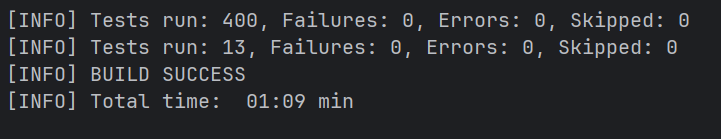

# Звіт про тести

Станом на 28.10.2026. Усі числа взяті з `./mvnw clean verify` на цій копії проєкту (Docker Desktop запущений, PostgreSQL 17 у Testcontainers).

## 1. Рівні тестів

| Рівень | Як запускається | Класів | Тестів | Час, с |
|---|---|---|---|---|
| Швидкі тести (`*Test`): сервіси, контролери, репозиторії, безпека, `ModulesTest` | `./mvnw test` | 37 | 305 | 9,2 |
| Інтеграційні тести через MockMvc на PostgreSQL (`@IntegrationTest`) | `./mvnw test` | 9 | 95 | 12,2 |
| REST end-to-end через `RestTestClient` (`*E2EIT`) | `./mvnw verify` | 3 | 8 | 11,4 |
| Браузерні тести Playwright (`*E2EIT`) | `./mvnw verify` | 3 | 5 | 4,0 |
| Разом | | 52 | 413 | |

Інтеграційні й end-to-end тести за модулями:

| Модуль | Інтеграційні (`@IntegrationTest`) | REST E2E | Браузерні E2E |
|---|---|---|---|
| `lot` | `LotCrudIntegrationTest`, `LotFormIntegrationTest` | `LotApiE2EIT` | `LotUiE2EIT` |
| `volunteer` | `VolunteerCrudIntegrationTest` (7), `ReservationIntegrationTest` (16) | `ReservationApiE2EIT` (2) | `ReservationUiE2EIT` (1) |
| `delivery` | `DestinationPointCrudIntegrationTest`, `DeliveryFlowIntegrationTest`, `DeliveryAlertIntegrationTest` | `DeliveryFlowE2EIT` | `DestinationPointUiE2EIT` |
| спільне | `TraceIdIntegrationTest`, `CurrentUserIntegrationTest` | | |

## 2. Час виконання

Повний `./mvnw clean verify`: близько 45 секунд (у цей час входять збірка, запуск двох контейнерів PostgreSQL і запуск браузера). Дані взято з `target/surefire-reports` і `target/failsafe-reports` (атрибут `time` у `TEST-*.xml`).

Найповільніші класи:

| Клас | Час, с | Чому |
|---|---|---|
| `DeliveryFlowE2EIT` | 10,9 | перший запуск контексту з реальним сервером і контейнером |
| `CurrentUserIntegrationTest` | 9,5 | перший запуск контексту й контейнера для MockMvc |
| `DestinationPointUiE2EIT` | 1,9 | перший запуск браузера Chromium |
| `ModulesTest` | 1,7 | перевірка меж модулів Spring Modulith |
| `LotUiE2EIT` | 1,4 | три сценарії в браузері |

## 3. Результат `./mvnw verify`



```
[INFO] Tests run: 400, Failures: 0, Errors: 0, Skipped: 0
[INFO] Tests run: 13, Failures: 0, Errors: 0, Skipped: 0
[INFO] BUILD SUCCESS
```

Перший рядок це швидкі й інтеграційні тести (surefire), другий end-to-end (failsafe).

## 4. Браузерні тести

Кожен тест Playwright записує trace у `target/playwright/trace-*.zip`. Відкрити: `npx playwright show-trace target/playwright/<файл>`. Сценарії: донор входить і створює лот через форму, бачить рядок у списку; волонтер не бачить кнопки створення; неправильний пароль показує повідомлення про помилку; волонтер входить і резервує лот на сторінці `/reservations` (повідомлення «Лот зарезервовано.» і рядок у таблиці резервувань); координатор входить і створює пункт призначення, бачить його в списку.

## 5. Чому так

Усі класи з однією анотацією (`@IntegrationTest` чи `@E2ETest`) мають однакові налаштування, тому Spring створює для них один контекст і один контейнер PostgreSQL, а не окремий на кожен клас. Це економить час: контейнер стартує один раз на групу. End-to-end тести (`*E2EIT`) винесені в Failsafe, бо вони повільніші (запускають сервер і браузер), і швидкий `./mvnw test` лишається коротким.

## 6. Відмінності від початкового плану

- Недозволений перехід статусу лота (повторна публікація, скасування лота в стані `RESERVED`) повертає `409`, як у контрактах №2 і №8 (`InvalidLotStateException` це `ConflictException`). Правила предметної області (`422`) лишилися для `BusinessRuleException`: наприклад, вікно самовивозу коротше за мінімум, неправильний код підтвердження, пункт призначення не приймає категорію.
- Скасування резерву на лоті не в стані `RESERVED` повертає `409`, як у матриці контракту №8. Раніше скасування на чернетці (`DRAFT`) повертало `204` і публікувало лот, бо перехід `DRAFT → PUBLISHED` дозволений; тепер `VolunteerServiceImpl.cancelReservation` спершу перевіряє статус, а тест `cancel_DraftLot_ShouldReturnConflictAndNotPublishDraft` це фіксує.
- Для тестів задано окремий профіль `test` з власним секретом JWT, щоб тести не залежали від файлу `.env`.
